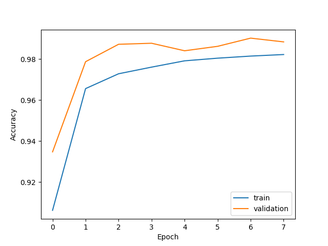
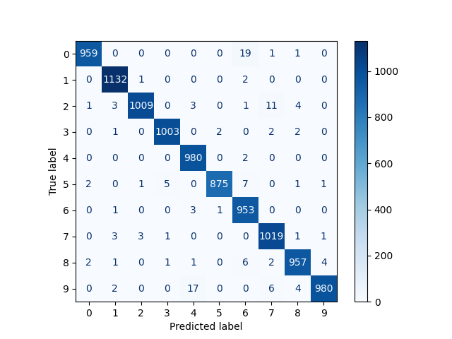
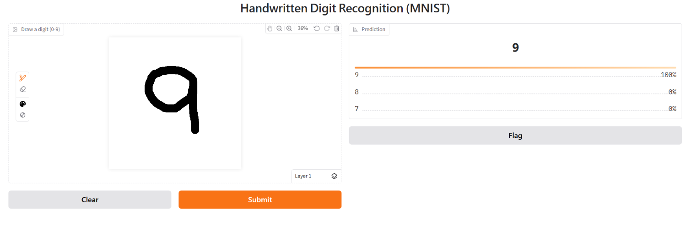

# ✍️ MNIST Digit Recognition using CNN

[](https://colab.research.google.com/drive/1mNhxNsvBsWVblTKUCV7jcyAf-EUDLgau)

## 📌 Project Overview

MNIST Digit Recognition is a Deep Learning project that recognizes handwritten digits (0–9) from images using a Convolutional Neural Network (CNN).

The model is built using TensorFlow and Keras and trained on the MNIST dataset, which contains 70,000 grayscale images of handwritten digits.

The project also includes a Gradio web application that allows users to draw a digit and instantly get the model's prediction.

## 🎯 Problem Statement

Computers often need to recognize handwritten digits for applications such as:

- Cheque processing
- Postal code recognition
- Form processing
- Bank document automation
- Digitized handwritten records

Since handwriting varies from person to person, traditional rule-based methods are not reliable. Deep Learning, particularly CNNs, can learn patterns from handwritten images and recognize digits accurately.

## 💡 Solution

A Convolutional Neural Network (CNN) is developed using TensorFlow/Keras to classify handwritten digits into 10 classes (0–9).

The model uses:

- Convolutional layers for feature extraction
- Batch Normalization for stable training
- Max Pooling for dimensionality reduction
- Dropout to reduce overfitting
- Data Augmentation using random rotation and zoom
- Softmax activation for digit classification

## 📊 Dataset

MNIST (Modified National Institute of Standards and Technology)

| Feature | Description |
|---|---|
| Total Images | 70,000 |
| Training Images | 60,000 |
| Testing Images | 10,000 |
| Image Size | 28 × 28 pixels |
| Color Format | Grayscale |
| Number of Classes | 10 (0–9) |

## 🧠 Model Architecture

The CNN model follows this architecture:

```
Input Image (28 × 28 × 1)
          |
 Data Augmentation
 (RandomRotation, RandomZoom)
 [training only]
          |
      Conv2D (32)
          |
   Batch Normalization
          |
      MaxPooling2D
          |
      Conv2D (64)
          |
   Batch Normalization
          |
      MaxPooling2D
          |
        Flatten
          |
     Dropout (0.4)
          |
      Dense (10)
          |
    Softmax Activation
          |
   Predicted Digit (0–9)
```

## 🚀 Model Performance

| Metric | Result |
|---|---|
| Test Accuracy | 98.92% |
| Dataset | MNIST |
| Framework | TensorFlow / Keras |
| Model Type | CNN |

The model achieves 98.92% test accuracy, demonstrating strong performance in handwritten digit classification.

## 🛠️ Technologies Used

- Python
- TensorFlow
- Keras
- NumPy
- Matplotlib
- Gradio
- Jupyter Notebook
- Google Colab

## 📂 Project Structure

```
mnist-digit-recognition/
│
├── MNIST_CNN.ipynb          # Model training notebook
├── app.py                   # Gradio web application
├── mnist_cnn_model.keras    # Trained model (loaded by app.py)
├── requirements.txt         # Project dependencies
├── README.md                # Project documentation
├── accuracy_plot.png        # Training accuracy graph
├── confusion_matrix.png     # Confusion matrix
├── app_demo.png             # App screenshot
└── test_model.py            # Model tests
```

## ⚙️ Installation and Setup

### 1. Clone the Repository

```bash
git clone https://github.com/arbind233/mnist-digit-recognition.git
```

### 2. Navigate to the Project Folder

```bash
cd mnist-digit-recognition
```

### 3. Install Dependencies

```bash
pip install -r requirements.txt
```

## ▶️ How to Run the Project

### Option 1: Using Google Colab

1. Open `MNIST_CNN.ipynb` in [Google Colab](https://colab.research.google.com/drive/1mNhxNsvBsWVblTKUCV7jcyAf-EUDLgau).
2. (Recommended) Switch to a GPU runtime: Runtime → Change runtime type → GPU.
3. Run all cells in order.
4. Wait for the model training to complete (approximately 3–5 minutes).
5. Run the `app.py` code in a new notebook cell to launch the Gradio application.
6. Draw a handwritten digit in the input box.
7. View the predicted digit and its confidence score.

### Option 2: Run Locally

After installing the dependencies, make sure the trained model file (`mnist_cnn_model.keras`) is in the project folder, then execute:

```bash
python app.py
```

Open the local Gradio URL displayed in the terminal.

## 🧪 Run Tests

To execute the project tests, run:

```bash
pytest
```

## 🌟 Features

- Recognizes handwritten digits from 0 to 9.
- CNN-based deep learning architecture.
- Data augmentation for improved generalization.
- Batch Normalization for stable learning.
- Dropout to help prevent overfitting.
- Interactive Gradio web interface.
- High test accuracy of 98.92%.

## 🔮 Future Improvements

- Improve accuracy using advanced CNN architectures.
- Support recognition of multiple handwritten digits.
- Deploy the application using Hugging Face Spaces.
- Build a mobile application for real-time digit recognition.
- Extend the model to recognize handwritten letters.

## 👨‍💻 Author

**Arbind Kumar** | CodeZoner Virtual Internship (ID: CZ-2026-0186)

- GitHub: [arbind233](https://github.com/arbind233)
- LinkedIn: [Arbind Kumar](https://linkedin.com/in/aarbind-kumar-btcs23r121/)

## 📸 Screenshots





## 🎥 Demo Video

[Watch the demo on Google Drive](https://drive.google.com/file/d/1ouSVigpLw3VqXuz-vXtuQnqZB_qjBfJm/view?usp=sharing)

---

⭐ If you find this project useful, consider giving it a star on GitHub!
